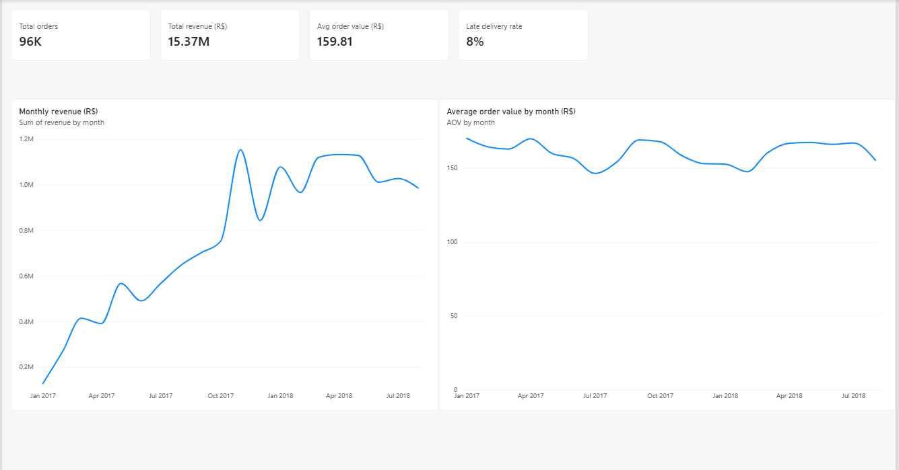
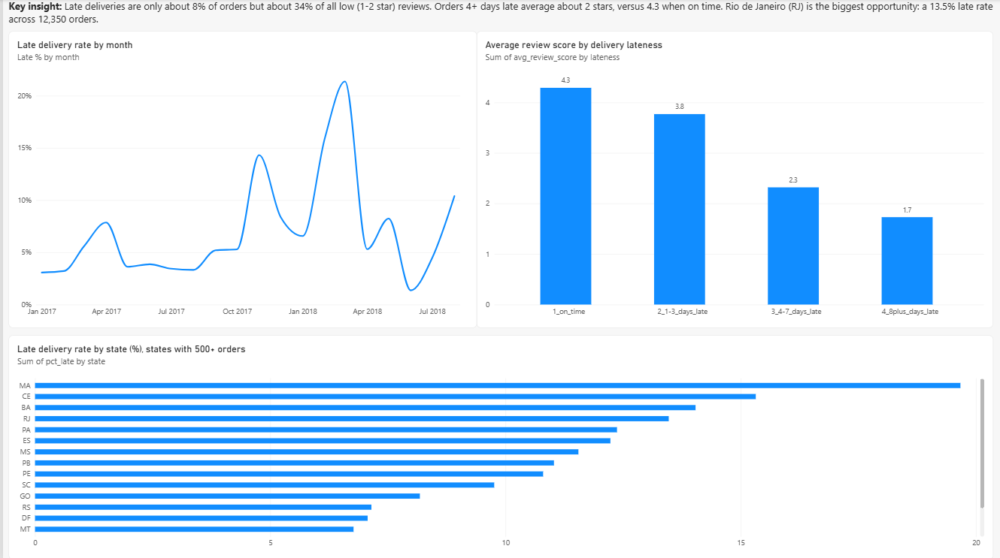
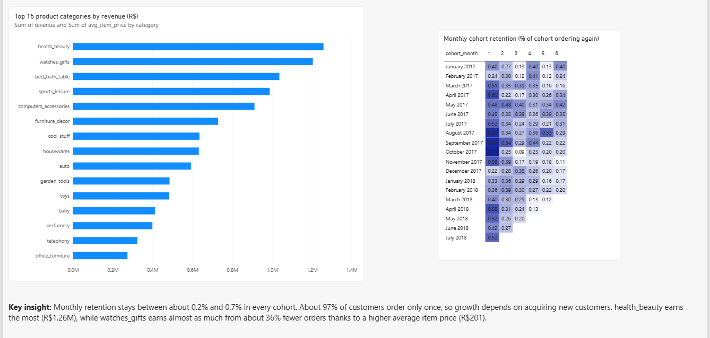

# Olist E-commerce Analytics: Delivery, Customer Satisfaction and Retention

An end-to-end analysis of about 100,000 orders from Olist, a Brazilian online marketplace (2016 to 2018). The project is SQL-first (DuckDB), uses Python for statistical testing, and ends with a 3-page Power BI dashboard and a business recommendations memo.

**Business question:** where does the marketplace lose customer satisfaction and repeat business, and what should the company fix first?

## Key findings

1. **Late delivery drives bad reviews.** Only 8.1% of delivered orders arrive after the estimated date, but they account for 33.8% of all 1-2 star reviews. Late orders average 2.57 stars versus 4.29 for on-time orders, and the score falls to 2.3 stars at 4-7 days late and 1.7 stars at 8+ days late.
2. **A late first delivery costs repeat purchases.** Customers whose first order was late placed a second order 3.04% of the time, versus 4.30% for on-time first orders (difference of 1.26 percentage points, 95% CI -1.93 to -0.59, p = 0.0013). This is observational data, so it shows an association, not proof of cause.
3. **Retention is very low everywhere.** 96.9% of customers order only once, and monthly cohort retention stays between about 0.2% and 0.7%. Growth depends on acquiring new customers.
4. **Rio de Janeiro (RJ) is the highest-impact place to improve.** RJ has a 13.5% late rate across 12,350 delivered orders (1,664 late orders), the second-highest count after SP, which has a 5.9% rate. Bringing RJ to SP's rate would remove roughly 930 late orders, about 12% of all late orders. The highest late rates are in MA (19.7%), CE (15.3%) and BA (14.0%).
5. **Growth came from order volume, not bigger baskets.** Average order value stayed between R$146 and R$170 every month, while monthly revenue grew from R$128k (Jan 2017) to about R$1.0M to R$1.15M from Nov 2017 onward.
6. **Category mix.** health_beauty earns the most (R$1.26M). watches_gifts earns almost as much (R$1.21M) from about 36% fewer orders because of a higher average item price (R$201).

## Dashboard





The Power BI file is in `dashboard/olist_dashboard.pbix`.

## A/B test design (simulation)

The dataset contains no real experiment, so this part is a **test design and simulation**, not an experiment result. The hypothesis: free shipping above a minimum basket value raises average order value.

- Order values are very skewed (mean R$160, median R$105, skew 9.4), so the metric is noisy.
- Orders needed per group (80% power, 5% significance): 73,616 to detect a 2% lift, 11,780 for 5%, and 2,946 for 10%.
- An A/A simulation (1,000 random splits) gave a 4.2% false positive rate, close to the expected 5%, so the testing setup is valid.
- Power simulation for a real 5% lift: 9% with 500 orders per group, 13% with 1,000, 19% with 2,000 and 42% with 5,000. Small tests would usually miss a real effect.
- Capping order values at the 99th percentile (R$1,053.61) cut the standard deviation from R$219 to R$164 and reduced the sample needed for a 5% lift from 11,780 to 7,133 per group.

## Tools and techniques

- **SQL (DuckDB):** joins, CTEs, window functions (`ROW_NUMBER`, `SUM() OVER`), cohort analysis, date arithmetic, data quality checks.
- **Python:** pandas, SciPy, statsmodels (two-proportion z-test, power analysis, A/A and power simulation), matplotlib and seaborn.
- **Power BI:** DAX measures, KPI cards, line and bar charts, matrix heatmap with conditional formatting.

## Project structure

```
Olist Analytics/
├── data/            Raw Kaggle CSVs (not included, see below)
├── sql/             6 documented SQL files with the findings in comments
├── notebooks/       01_setup_and_explore.ipynb (all analysis cells)
├── exports/         Clean CSVs used by the dashboard
├── dashboard/       olist_dashboard.pbix
├── images/          Dashboard screenshots and cohort retention heatmap
├── docs/            business_memo.md
├── requirements.txt
└── README.md
```

## How to reproduce

1. Download the **Brazilian E-Commerce Public Dataset by Olist** from Kaggle (`olistbr/brazilian-ecommerce`) and place the 9 CSV files in a `data/` folder.
2. Create and activate a virtual environment, then install the packages:
   ```
   python -m venv .venv
   .venv\Scripts\activate
   python -m pip install -r requirements.txt
   ```
3. Open `notebooks/01_setup_and_explore.ipynb` and choose **Run All**. The first cells load the CSVs into a local `olist.duckdb` file.
4. The SQL files in `sql/` can be run on the same DuckDB database.

## Methodology notes and limitations

- **Analysis window:** Jan 2017 to Aug 2018. Other months have almost no orders (the dataset starts and ends sparsely).
- **Customers:** `customer_id` is generated per order, so all retention work uses `customer_unique_id`.
- **Delivery metrics** use delivered orders that have a delivery date. "Late" means delivered after the estimated date. 8 delivered orders without a delivery date were excluded.
- **Reviews:** some orders have several reviews, so scores are averaged per order before joining.
- **Revenue:** order value in the monthly summary is the sum of payments (items plus shipping). Category revenue uses item price only and includes all order statuses.
- **Cohort retention:** the Aug 2018 cohort is excluded because the dataset ends shortly after it. Early cohorts are small, so single cells are noisy.
- **Causality:** all findings are observational. Late orders may differ in region, product or seller.

## Business memo

See [docs/business_memo.md](docs/business_memo.md) for the recommendations.

## Author

Built by Piyush ([@piyushweb-ai](https://github.com/piyushweb-ai)). Data: Olist, via Kaggle.
